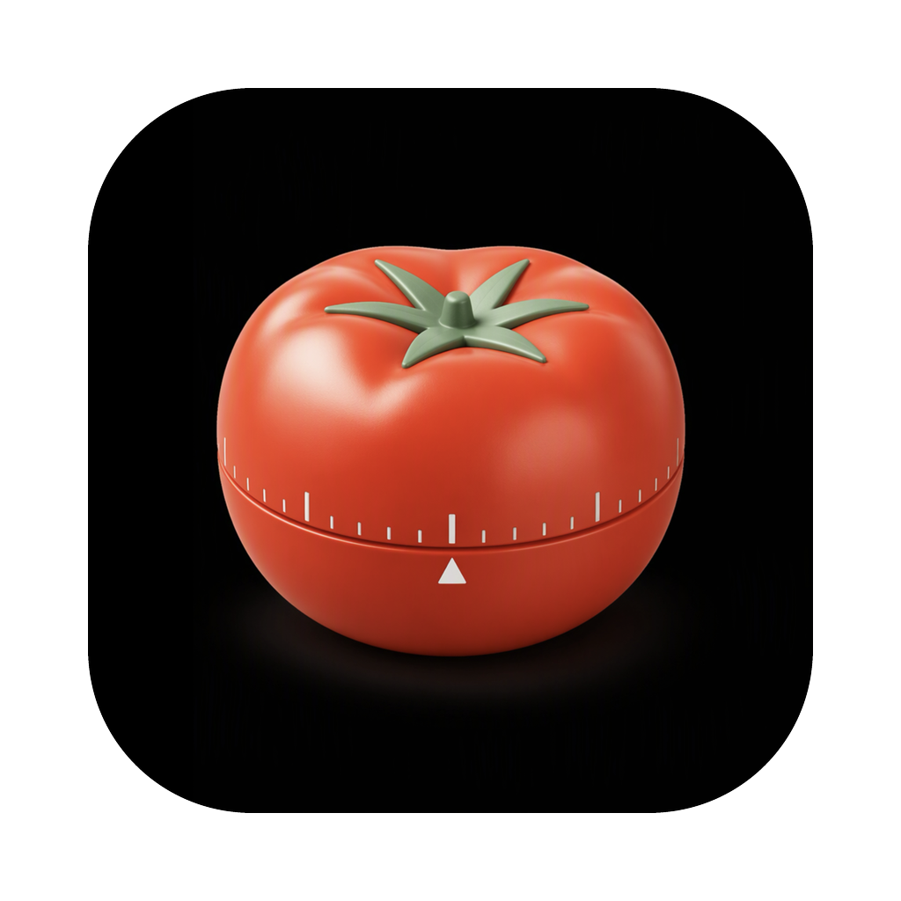
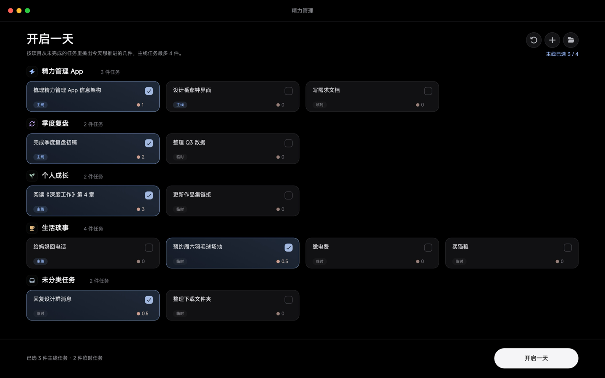
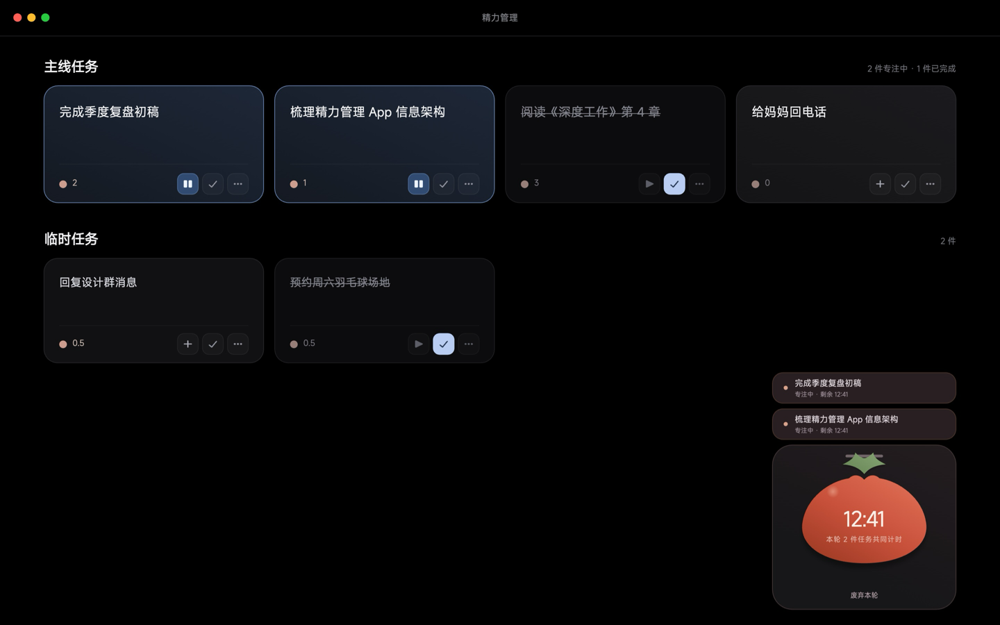
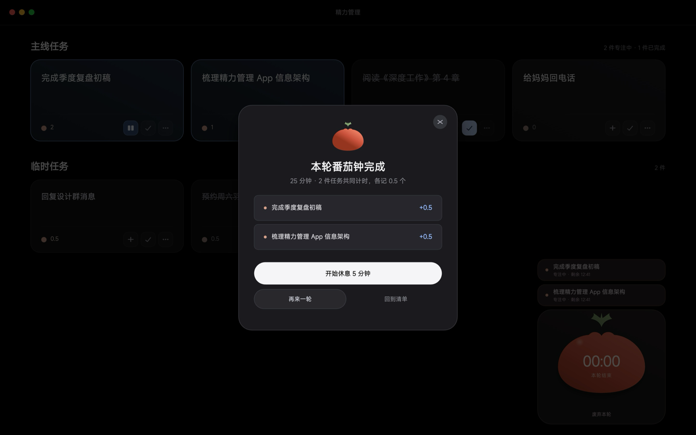
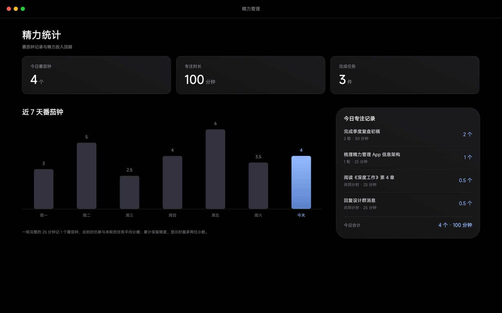

  

# 精力管理 · Jingli

一个只服务「今天」的 macOS 番茄钟。

每天从项目里挑最多 4 件主线任务，再带上几件临时任务，一起进入一轮 25 分钟共享番茄钟；结束后按 `1/n` 自动分摊。菜单栏倒计时、置顶浮窗、全局完成弹窗和系统通知，让你在写代码、开会、切应用时都不用回到主窗口。

界面刻意不堆历史：打开就是今天，跨天回到「开启一天」，未完成任务回到未安排。但数据不会丢，需要复盘时可以让 Agent 按天回顾「哪天完成了哪些任务、花了多少时间」。

## 设计稿

完整 4 页设计稿：[精力管理-Mac应用设计稿.pdf](Design/精力管理-Mac应用设计稿.pdf)

| 开启一天 | 今日任务 + 浮窗 |
| --- | --- |
|  |  |
| **完成弹窗** | **统计设计稿** |
|  |  |

> 设计稿第 4 页包含「近 7 天番茄钟」柱状图；当前版本的界面没有做这张图，统计页只展示今日 KPI 和今日记录。历史回顾通过 Agent 的按天查询完成。

## 它解决什么问题

- **每天只选 4 件主线**：减少面对无限长待办清单的决策成本。
- **多任务共享一轮番茄钟**：适合「写方案 + 回消息 + 查资料」这类并行工作，结束时按参与任务均分，不会重复计时。
- **专注状态始终可见**：菜单栏、浮窗、完成弹窗、通知四个层级，不打断当前应用。
- **今天归今天**：主界面不背历史包袱；需要复盘时再按天查。

## 核心功能

### 开启一天

按项目分组展示未完成任务，勾选今天要推进的几件。主线最多 4 件，临时任务不限。底部实时显示已选数量，点「开启一天」进入今日页。

### 今日任务

主线任务和临时任务分区展示。每张卡片可以直接开始 / 暂停番茄钟、标记完成、打开详情。右上角「+」只加临时任务；主线任务来自项目，今日页只读（能看、能完成，不能改），要改回项目里改。完成的任务置灰划线，仍占主线名额；「重置」可以把今天退回开启一天。

### 共享番茄钟

一轮固定 25 分钟。可以先选一件任务开始，再把其他任务加入同一轮；中途加入的任务从加入时刻开始参与分摊。暂停保持当前剩余时间，继续后接着走。结束、废弃、休息都有明确入口。

### 完成结算

一轮结束后弹出全局完成弹窗，逐个任务显示 `+1/n` 分摊，并提供「开始休息 5 分钟」「回到清单」。按番茄钟规则，这里不提供直接开下一轮的入口；休息是独立的 5 分钟倒计时，可跳过，不计入番茄统计，结束后再手动开始新一轮。

### 菜单栏、浮窗与通知

- 菜单栏实时显示剩余时间，可直接暂停 / 继续 / 废弃 / 快速添加任务。
- 浮窗始终置顶、跨 Space，可拖动并记住位置；显示当前计时、本轮任务名与分摊。开关状态也会记住：上次开着，重启后自动恢复；用过浮窗的话，点「开启一天」会默认打开。一轮结束后浮窗会保留上一轮任务，可以逐条移除，再点「继续上一轮」直接按剩下的任务开新一轮。
- 完成时发系统通知，通知上直接带「开始休息 / 回到清单」操作。
- 主窗口关闭后 App 留在菜单栏，不会退出。

### 勿扰联动

开始番茄钟自动进入勿扰；暂停保持；完成、废弃、休息、退出时自动退出。开始前如果已经有其他 Focus，不会接管，也不会在结束时关掉它。没有配置快捷指令时只提示，不影响计时。

### 项目

项目网格展示每个项目的任务数；项目详情里可以添加任务、编辑项目名称 / 描述 / 颜色、删除项目。删除项目时任务会保留，并移到「未分类」。

### 统计与历史

统计页展示今日番茄数、专注时长、完成任务数和今日专注记录。

需要回顾更长时间时，可以让 Agent 查询任意日期或最近 N 天：每天返回番茄数、专注时长、完成的任务、每一轮番茄及任务分摊。历史从当前版本开始保留。

### 设置与数据

- 勿扰开关、快捷指令检查、测试通知。
- 每日首次启动自动生成 JSON 备份，保留 14 天；支持手动备份和从备份导入。
- 可选择开机自动启动。
- 所有数据只存在本机，不上传云端。

### Agent 支持

内置 CLI 和 Agent Skill，可以创建项目、添加 / 修改 / 完成任务、排今天的主线、开始 / 暂停 / 停止番茄钟、查今日统计和历史、查看审计记录、撤销写操作。破坏性操作需要确认。今天开始后只能加临时任务，主线要回项目里维护。

## 使用流程

1. 打开 App，在「开启一天」里勾选今天的主线任务和临时任务。
2. 点「开启一天」，进入今日页。
3. 点任意任务的播放按钮开始 25 分钟；需要一起计时就把其他任务加入本轮。
4. 结束后在完成弹窗里开始 5 分钟休息，或回到清单。
5. 需要复盘时，让 Agent 查某一天或最近几天的番茄和任务完成情况。

## 设计原则

- **今天优先**：主界面永远只回答「今天做什么」，不把历史图表塞进每天的工作流。
- **少打扰**：常驻菜单栏和浮窗，但只在轮次结束时主动出现。
- **本地优先**：SQLite + 本地 socket，账号、云同步、远端服务都不是必需。
- **可被 Agent 操作**：所有核心能力都有稳定的 CLI / Skill 接口，而不只是 UI 点击。

## 当前状态

- 原生 SwiftUI + AppKit，本地 SQLite。
- 已实现项目 / 任务 / 今日计划 / 共享番茄钟 / 休息 / 勿扰 / 通知 / 浮窗 / 统计 / 历史 / 备份 / Agent。
- 计时与休息长度固定 25 / 5 分钟。
- 勿扰需要两个系统快捷指令；未配置时计时不受影响。
- 历史从当前版本开始保留，更早的记录无法恢复。
