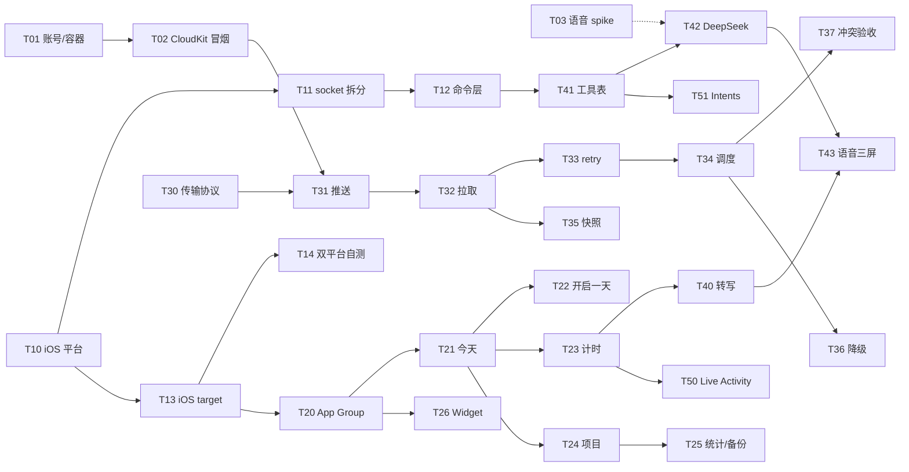

# 精力管理 iOS + iCloud · 实施拆分

> v1 · 2026-11-17 · 配套：[iOS 设计稿](../Design/ios-design.html)（15 屏） · [技术设计](ios-icloud-design.md) · [架构图](ios-icloud-architecture.svg)
> 硬性要求：**iCloud 必须能把数据同步起来**（不是"预留接口"，是双端跑通、能验收）。

---

## 0. 完成定义（DoD）

一个版本算完成，必须同时满足：

| # | 验收 | 怎么验 |
|---|---|---|
| 1 | iPhone 上不插电跑完整一天：开启一天 → 4 件主线 → 共享番茄 → 结算 → 统计 | 真机手工过一遍 |
| 2 | Mac 与 iPhone **双向同步**：任一端改动 30 秒内出现在另一端 | 双端对照 |
| 3 | 离线可写，恢复后自动追平，不丢改动 | 飞行模式改 3 处再联网 |
| 4 | 冲突按字段合并：A 改标题、B 改备注 → 两边都在 | 见 §5.4 用例 |
| 5 | 一台删任务、另一台离线改标题 → 删除赢，不复活 | 见 §5.4 用例 |
| 6 | 语音录入：说完 → 解析 → 确认 → 进今天，≤ 3 次操作 | 真机 + 关网各测一次 |
| 7 | 没有 iCloud 账号 / 配额满 / 断网：App 完整可用，只不同步 | 关 iCloud 跑一天 |

> 第 2、3、4、5 条是这次的重点。**任何一条不过，M3 不算完。**

---

## 进度

| 日期 | 已完成 | 卡在哪 |
|---|---|---|
| 2026-11-17 | T03 语音链路 spike、T10 iOS 平台、T11 socket 拆分、T12 命令层、T13 iOS target、T21–T26（M2 全部界面 + 任务/项目增删改 + 设置页 + Widget）、T33 sync_retry、T30 SyncEngine + FakeTransport、T31 CloudKit transport（真机 iCloud 往返已打通）、T32 同步调度待接入、T41 ToolCatalog（8 个工具）、T42 OpenAI 兼容 provider + Agent 循环、T43 助手对话界面（真实模型在 App 里跑通）、T40 端上转写接入（权限流程已验证）、T50 Live Activity（已启动成功；模拟器 runtime 不渲染动态岛，渲染待真机验） | T01 iCloud 能力被开发者协议（PLA）拦住；T02 真机断开；T31/T32 CloudKit 实现等 container |

> 恢复工作时先看这张表：T01 不解决，M3 整段动不了。

## 1. 拆分原则

- 按**可独立验收的纵向切片**拆，每个任务 0.5–2 天，做完就能编译 + 跑测试。
- 每个任务都有"改哪些文件"和"怎么算完"，不写"优化同步逻辑"这种无法验收的条目。
- 顺序上先打通"能跑"，再加"能同步"，最后加"能说话"——因为同步会反过来改数据层，晚做要返工。
- 单人开发，估时按每天 2–3 小时有效投入算（这是这个项目的真实节奏）。

---

## 2. 里程碑总览

| 里程碑 | 内容 | 任务数 | 估时 | 出口 |
|---|---|---|---|---|
| M0 准备 | 账号、签名、语音链路验证 | 3 | 1 天 | CloudKit 能写能读；DeepSeek 能解析一句话 |
| M1 拆包 | Core 跨平台、socket 分离、iOS target | 5 | 2 天 | 同一份 Core 在 iOS 模拟器编译通过 |
| M2 iOS 本地 | 今天 / 项目 / 统计 / 计时 / 备份 | 7 | 4 天 | 断网可用一整天 |
| M3 iCloud 同步 | 传输层、推送拉取、快照、冲突验收 | 8 | 4 天 | **DoD 2–5 全过** |
| M4 语音与模型 | 转写、工具表、DeepSeek、确认 UI | 6 | 3 天 | DoD 6 过 |
| M5 系统入口 | Live Activity、Widget、App Intents | 4 | 3 天 | 锁屏能看倒计时，Siri 能加任务 |
| M6 打磨 | Face ID、空态、文案、真机回归 | 4 | 2 天 | 一周真实使用无阻断 |
| **合计** | | **37** | **19 天** | |

依赖关系：M0 → M1 → M2 → M3 →（M4、M5 可并行）→ M6。

---

## 3. 任务清单

### M0 · 准备（1 天）

| ID | 任务 | 改动 / 产出 | 依赖 | 完成标准 | 天 |
|---|---|---|---|---|---|
| T01 | 确认开发者账号与 CloudKit 容器 | Apple Developer 后台建 `iCloud.com.freedom-shen.jingli`；`.entitlements` 两份（探针见 [`Spikes/cloudkit-probe`](../Spikes/cloudkit-probe/)） | — | 后台能看到容器；两个 bundle id 都勾上 CloudKit | 0.5 |
| T02 | 最小 CloudKit 冒烟 | 临时 target：写 1 条 `CKRecord` → 另一台设备读到 | T01 | 两台设备（Mac + iPhone）能互读一条记录 | 0.5 |
| T03 | 语音链路验证脚本 | ✅ `scripts/voice-spike.sh`：转写文本 → 模型 → 打印 `task.add` 参数（ASR 在端上，脚本吃转写结果） | 已有 Key | 一句话能正确产出 title/lane/date/estimate | 0.5 |

> T01 是**阻塞项**：没有付费账号，M3 整段做不了。退化路径见 §7。

**T03 已知参数**（实测过）：

```
endpoint  https://opencode.ai/inference/go/openai/v1/chat/completions
model     deepseek-v4.1-flash
header    x-opencode-session: dsh-opencodego-shen
协议      OpenAI 兼容，tools / tool_choice 可用
```

### M1 · 拆包（2 天）

| ID | 任务 | 改动文件 | 依赖 | 完成标准 | 天 |
|---|---|---|---|---|---|
| T10 | Package 支持 iOS | `Packages/JingliCore/Package.swift`：`platforms: [.macOS(.v15), .iOS(.v17)]` | — | `swift build --triple arm64-apple-ios17.0` 通过 | 0.5 |
| T11 | socket 拆出去 | 新建 `Sources/JingliAgentSocket/`，把 `AgentServer` 的 `Darwin`/`accept`/`bind` 挪进去 | T10 | macOS 仍能 `jingli ping`；Core 不再 import Darwin | 0.5 |
| T12 | 命令层保持单一入口 | `AgentServer` 只剩 IO，调 `AgentCommandRouter.process(line:)` | T11 | `AgentServer` ≤ 120 行；29 个方法测试不变 | 0.5 |
| T13 | iOS target | 新建 `iOS/project.yml`（XcodeGen）+ `iOS/Jingli/`，先只有空壳 | T10 | 模拟器能起 App，能打开 GRDB 内存库 | 0.5 |
| T14 | 双平台自测 | `scripts/self-test.sh` 增加 iOS 编译；`swift test` 保持绿 | T13 | `--fast` 在本机通过 | 0.5 |

### M2 · iOS 本地 MVP（4 天）

| ID | 任务 | 改动文件 | 依赖 | 完成标准 | 天 |
|---|---|---|---|---|---|
| T20 | 数据落 App Group | `AppPaths` 增加容器注入；`iOS/Jingli/AppServices.swift` 用 `group.com.freedom-shen.jingli` | T13 | 主 App 与 Widget 都能打开同一个库（Widget 只读） | 0.5 |
| T21 | 今天页 | `iOS/Features/Today/`：主线区 / 临时区 / 完成态 / 空态 | T20 | 与设计稿 02 一致；完成置灰划线仍占名额 | 1 |
| T22 | 开启一天 | `iOS/Features/DayStart/`：按项目分组、4 件上限、临时不限 | T21 | 第 5 件点选被拒并提示 | 0.5 |
| T23 | 番茄计时 | 复用 `FocusTimer` + `FocusTimerStore`；本地通知 + 回前台对时 | T21 | 锁屏 25 分钟回来正确记 1 个番茄 | 1 |
| T24 | 项目 / 项目详情 | `iOS/Features/Projects/`：网格、任务增改、今天已开始的锁定文案 | T21 | 与设计稿 05/06 一致 | 0.5 |
| T25 | 统计 + 备份 | `StatsView`（今日 KPI + 今日记录）、`BackupService` 接 Documents | T24 | 统计数字与 Mac 同口径 | 0.5 |
| T26 | Widget 只读 | `Packages/JingliWidgets/`：中号 Widget 读 Agent Group 的库 | T20 | 主屏显示今日番茄与下一件 | 0.5 |

### M3 · iCloud 同步（4 天）· 核心

| ID | 任务 | 改动文件 | 依赖 | 完成标准 | 天 |
|---|---|---|---|---|---|
| T30 | 传输协议 + 假实现 | 新建 `Sources/JingliSync/SyncTransport.swift`、`FakeTransport.swift` | M2 | 现有 `SyncTests` 能改成端到端双端用例 | 0.5 |
| T31 | 推送 | `CloudKitTransport.push(_:)`：`CKModifyRecords`，`recordName = deviceID:seq`，批量 200 | T30 | 两台设备各写 500 条不重复不丢 | 1 |
| T32 | 拉取 | `CloudKitTransport.pull(since:)`：custom zone + `serverChangeToken` | T31 | 断点续拉；重复投递幂等 | 0.5 |
| T33 | **补外键跳过丢变更的洞** | 新增 `sync_retry` 表 + `SyncStore.apply` 返回被跳过项 | T32 | 先到 task、后到 project 时，project 到达后 task 能落库 | 0.5 |
| T34 | 调度 | `SyncEngine`：写后 2s 推、前台拉、`BGAppRefreshTask`、静默推送订阅 | T32 | 前端改完 30 秒内对端可见 | 0.5 |
| T35 | 快照与首屏 | `Snapshot` 记录（gzip + `CKAsset`），新设备 bootstrap | T32 | 新装 iPhone 10 秒内看到 Mac 全部数据 | 0.5 |
| T36 | 降级与状态 | 无账号 / 配额满 / 断网 → 静默本地；设置页显示上次同步与待推送数 | T34 | DoD 7 过 | 0.25 |
| T37 | 冲突验收 | `Tests/` + 双真机手工：§5.4 的 7 条用例 | T34 | 7/7 通过，写进 `docs/sync-acceptance.md` | 0.25 |

### M4 · 语音与模型（3 天）

| ID | 任务 | 改动文件 | 依赖 | 完成标准 | 天 |
|---|---|---|---|---|---|
| T40 | 端上转写 | `iOS/Voice/SpeechTranscriber.swift`：`SpeechAnalyzer` + 中文 locale | M2 | 说 5 句话，转写成功率 ≥ 80%（安静环境） | 1 |
| T41 | 工具表 + 提示词 | `Sources/JingliAgent/ToolCatalog.swift`：29 个方法 → JSON Schema；system prompt 内联 SKILL.md 的硬规则 | T12 | `task.add` 的 schema 与 SKILL.md 一致；**「两个钟」必须解析成 5 个番茄**（25 分钟一个、向上取整） | 0.5 |
| T42 | DeepSeek provider | `OpenAICompatibleProvider`：baseURL/model/Key + 自定义 header；Key 进 Keychain | T41 | 一句话 → 正确 `tool_call` | 0.5 |
| T43 | 语音三屏 | 新建任务 / 按住说话 / 解析结果（设计稿 13–15） | T40,T42 | 说完到确认 ≤ 3 次操作 | 0.5 |
| T44 | 确认与审计 | 解析结果可改，确认后 `AGENTRouter` 写入，`agent_event` 记录 | T43 | 撤销能用；破坏性操作仍二次确认 | 0.25 |
| T45 | 端上模型兜底（可选） | `FoundationModelsProvider`（iOS 26+） | T42 | 无网时也能解析简单句子 | 0.25 |

### M5 · 系统入口（3 天）

| ID | 任务 | 改动文件 | 依赖 | 完成标准 | 天 |
|---|---|---|---|---|---|
| T50 | Live Activity | `Packages/JingliWidgets/`：`ActivityKit` + 结束时间自渲染 | M2 | 锁屏与灵动岛显示剩余时间，锁屏可暂停 | 1 |
| T51 | App Intents | 加任务 / 开始专注 / 完成 / 今日摘要 4 个 Intent | T41 | 快捷指令能跑通 | 1 |
| T52 | Widget 交互按钮 | Widget 里的「开始一轮」走 App Intent | T51 | 点击后主 App 起一轮 | 0.5 |
| T53 | 通知动作 | 完成通知带「休息 / 回清单」 | M2 | 点通知直接进对应状态 | 0.5 |

### M6 · 打磨（2 天）

| ID | 任务 | 完成标准 | 天 |
|---|---|---|---|
| T60 | Face ID 锁、空态、错误文案 | 所有错误文案与 CLI 一致 | 0.5 |
| T61 | 截图基线 | 新增 6 张 iOS 基线，`snapshot.sh` 覆盖 | 0.5 |
| T62 | 真机一周回归 | 每天真实用，记录阻断问题 | 0.5 |
| T63 | 文档与发布 | README / 设计稿 / 技术稿同步更新；打 tag | 0.5 |

---

## 4. 依赖图



关键路径：**T01 → T02 → T31 → T32 → T33 → T34 → T37**。这条链上任何一环卡住，DoD 2–5 都过不了。

---

## 5. iCloud 同步：不能改的部分

### 5.1 记录模型

| Record | recordName | 关键字段 |
|---|---|---|
| `Change` | `<deviceID>:<seq>` | entity / entityID / field / valueJSON / rev / ms |
| `Snapshot` | `snapshot` | snapshotRev + gzip payload（CKAsset） |
| `Presence` | `<deviceID>` | platform / lastSeenAt / activeTaskIDs（可选） |

- 自定义 Zone `JingliZone`（默认 zone 拿不到 change token）。
- **deviceID 每次安装重新生成**（`SyncSchema` 已是 `UUID()`）；用 IDFV 会在重装后撞 `<deviceID>:1`。

### 5.2 推送 / 拉取

```
push: SELECT * FROM sync_change WHERE pushed_at IS NULL ORDER BY seq LIMIT 200
      CKModifyRecords(savePolicy: .changedKeys) → 逐条标 pushed_at

pull: CKFetchRecordZoneChanges(previousChangeToken) → SyncStore.apply()
      → 存 serverChangeToken 到 sync_meta（设备本地，不上云）
```

### 5.3 必须自己补的洞

`SyncStore.apply` 遇到外键约束失败会 `continue`（对端还没同步到被引用的 task）。原来的 LeanCloud 方案靠"多拉 2 分钟重叠窗口"兜底；**CloudKit 用 token 之后，被跳过的变更不会重投**。

> 所以 T33 不是优化项，是正确性项：`sync_retry` 表 + 每轮 pull 前先 drain。

### 5.4 冲突验收矩阵（7 条，必须全过）

| # | 场景 | 期望 |
|---|---|---|
| 1 | 双端离线各改同一任务的不同字段 | 合并后两个字段都在 |
| 2 | 一端删任务，另一端离线改标题 | 删除赢，不复活 |
| 3 | A 排了今天，B 离线三天后上线 | B 不覆盖 A 的今天 |
| 4 | 双端同时把同一任务加入今天 | 幂等，只有一条 `dayPlanTask` |
| 5 | 双端各加一件临时任务 | 并集，两条都在 |
| 6 | 同一秒两端改同一字段 | 结果确定（rev 大者胜），双端一致 |
| 7 | 先到 task 后到 project（跨批） | 重试后 task 落库，不丢 |

### 5.5 权限（T01 产出）

```xml
<key>com.apple.developer.icloud-container-identifiers</key>
<array><string>iCloud.com.freedom-shen.jingli</string></array>
<key>com.apple.developer.icloud-services</key>
<array><string>CloudKit</string></array>
```

Mac 端现在 `CODE_SIGN_IDENTITY: "-"`（[App/project.yml](../App/project.yml)），启用后 Debug 也必须带 entitlement，否则 `CKError.permissionFailure`。

---

## 6. 排期建议（单人，每天 2–3 小时）

| 周 | 做什么 | 周末应达到 |
|---|---|---|
| W1 | M0 + M1 | 两台设备能互读一条 CloudKit 记录；iOS 空壳能跑 |
| W2 | M2 | iPhone 上断网能过完一天，计时正确 |
| W3 | M3 | 双端同步跑通，7 条冲突用例全绿 |
| W4 | M4 + M5 | 语音能录入；锁屏能看倒计时 |
| W5 | M6 + 真机回归 | 一周真实使用无阻断 |

如果只有周末：把 M4 的 T45 和 M5 的 T52 砍掉，先保证 M0–M3。

---

## 7. 风险与前置换算

**2026-11-17 实测（真机 iPhone 16 Pro Max / iOS 26.5）**：Team `W695YL8UYY` 能签名、能装包、能启动；
加 iCloud entitlement 后被 **PLA（开发者协议）** 拦住——需要先在 developer.apple.com/account 同意最新协议，
`-allowProvisioningUpdates` 才能创建 container 和 profile。这条不解决，T31 起全部做不了。


| 风险 | 触发条件 | 现在就要做的决定 |
|---|---|---|
| 没有付费开发者账号 | T01 卡住 | 先做 M1+M2（本地版），同步用"备份文件 AirDrop"过渡；架构不改 |
| CloudKit 拒绝 Mac 签名 | T02 失败 | 先只做 iPhone ↔ iPhone 同步，Mac 端后补 |
| iOS 后台不执行 | T34 验收不过 | 降级为"前台即时 + 打开 App 追平"，UI 明确显示上次同步时间 |
| 双端同时计时导致番茄翻倍 | 真实使用 | 只做 Presence 提示，不做仲裁（v1 决定） |
| DeepSeek 通道不稳定 | T42 失败 | 换官方 `api.deepseek.com`，只改 baseURL；或退回端上模型 |
| 语音识别中文准确率低 | T40 验收不过 | 保留键盘听写作为兜底，语音只做"加临时任务"这一种句式 |

---

## 8. 每个里程碑的验收命令

```bash
# 每个任务做完都要跑
cd Packages/JingliCore && swift test
scripts/self-test.sh --fast

# M1 之后：iOS 也能编译
xcodebuild -project iOS/Jingli.xcodeproj -scheme Jingli \
  -destination 'platform=iOS Simulator,name=iPhone 16' build

# M2 之后：装着跑一天
xcrun simctl install booted <app>; xcrun simctl launch booted com.freedom-shen.jingli.ios

# M3 之后：双端冲突（先手工，后来自动化）
scripts/sync-acceptance.sh   # 待新建，跑 §5.4 的 7 条

# 发布前
scripts/self-test.sh --full
```

---

## 9. 和现有工作的关系

- **不动**：`RemoteWebServer`（手机网页）、`AgentCommandRouter`、`SyncStore.apply`、`SyncSchema`、`FocusTimer`。
- **新增**：`Sources/JingliAgent`（工具表）、`Sources/JingliAgentSocket`（socket 分离）、`Sources/JingliSync`（传输层）、`iOS/`、`Packages/JingliWidgets/`。
- **改动**：`Package.swift` 平台、`AppPaths` 容器注入、`AgentServer` 只留 IO、`SyncStore.apply` 返回被跳过项、`App/project.yml` 签名。
- **文档**：`docs/ios-icloud-design.md`（已完成）、本文件（拆分）、`docs/sync-acceptance.md`（M3 产出）。

## CloudKit 真机自检记录（2026-11-17）

- 开发者协议（PLA）已接受，账号恢复正常访问。
- 新建 App ID：`Jingli iOS` / `com.freedom-shen.jingli.ios`，开启 iCloud（CloudKit）与 App Groups。
- 新建 iCloud 容器：`iCloud.com.freedom-shen.jingli`，并已分配给该 App ID。
- 新建 App Group：`group.com.freedom-shen.jingli`。
- 真机构建 / 安装 / 启动均成功，entitlements 正确（容器 + CloudKit + App Group）。
- 真机自检结果：
  - `accountStatus=1`（iCloud 可用）
  - `userRecordID` 获取成功
  - **写默认 zone / 自定义 zone 均返回 `CKError 15 / CKInternalErrorDomain 2000`**
- 根因：CloudKit Console 默认打开的是另一个 team（Havells India Limited），容器从未被"打开"过，服务端因此拒绝一切写入。切到 `xiaomin shen W695YL8UYY` 并进入该容器的 Development / Records 页后，立刻恢复正常。
- 修复后真机结果：
  - `zone created` ✅
  - `default zone write ok` ✅
  - `push accepted=1` / `pull count=1 foundOwn=true` ✅
  - 完整同步：`待推送=9 → pushed=9，pulled=9 applied=9 skipped=0` ✅
- 顺带修掉一个隐患：`withSuppressed` 的标记在进程被强杀时会残留，之后所有本地写入都不再产生同步变更。现在每次打开库都会清一次（`SyncSchema.clearStaleSuppression`）。
