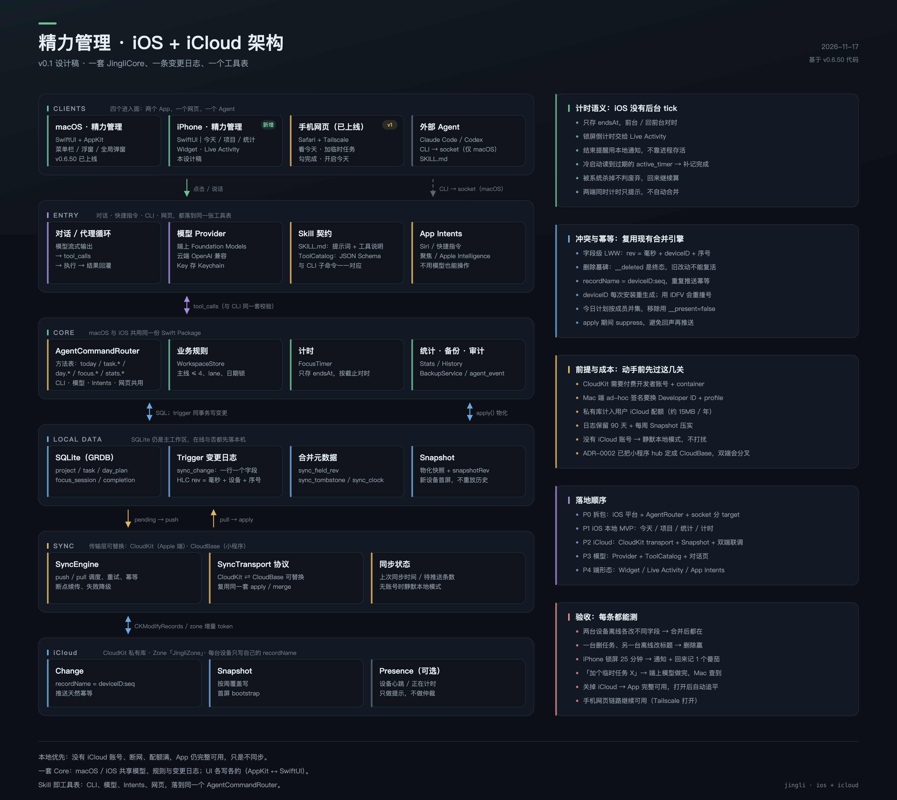
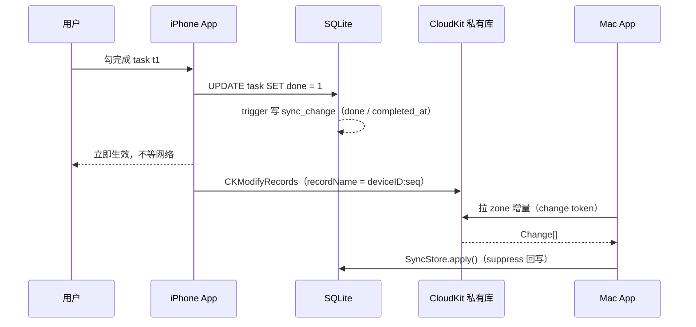

# 精力管理 · iOS 版 + iCloud 同步 · 设计稿

> v0.1 · 2026-11-17 · 基于当前代码：v0.6.50 + 手机网页 v1（`3f8bd08`）+ [ADR-0002 换 CloudBase](adr/0002-sync-backend-cloudbase.md)
>
> 配套架构图：[`ios-icloud-architecture.svg`](ios-icloud-architecture.svg)（可编辑）· [`ios-icloud-architecture.png`](ios-icloud-architecture.png)（2x）



---

## 1. 一句话

把「今天」搬到 iPhone：**同一份 `JingliCore`、同一条 SQLite 变更日志**，用 **iCloud（CloudKit 私有库）** 做传输；模型和 Skill 不另写一套，而是把已经拆好的 **`AgentCommandRouter`（29 个方法）** 变成**一张工具表**，让「App 内对话 / Siri 与快捷指令 / 手机网页 / 外部 Agent」四个入口落到同一个执行器。

昨天上线的**手机网页**（Safari + Tailscale）已经把「看今天 / 加临时任务 / 勾完成」跑通了，所以这次不是从零开始：

| 层 | 现在 | 本设计稿 |
|---|---|---|
| 命令层 | `AgentCommandRouter`（已抽出，CLI / 网页共用） | 再给模型和 App Intents 用 |
| 传输层 | 局域网 HTTP + token（手机网页） | iCloud 变更日志（原生 App） |
| 界面 | 一个内联 HTML 页 | 原生 SwiftUI + Widget + Live Activity |

三件事分开看：

| 事情 | 做法 | 不做什么 |
|---|---|---|
| iOS App | 新写 SwiftUI 界面，复用 Core | 不把 AppKit 代码搬过去 |
| iCloud | 只传**变更日志**，不传 SQLite 文件 | 不把库放 iCloud Drive（会损坏） |
| 模型 / Skill | 一张 ToolCatalog + 一份 SKILL.md | 不维护第二套命令语义 |

---

## 2. 读代码得到的现状

### 2.1 已经能直接复用的

| 能力 | 位置 | 说明 |
|---|---|---|
| 数据模型 + 迁移 | [`JingliDatabase.swift`](../Packages/JingliCore/Sources/JingliCore/JingliDatabase.swift) | v1 → v6，业务表 + `sync_*` 元数据，GRDB |
| 变更捕获 | [`SyncSchema.swift`](../Packages/JingliCore/Sources/JingliCore/SyncSchema.swift) | SQLite trigger 自动写 `sync_change`，一行一个字段，HLC `rev` |
| 合并引擎 | [`SyncStore.swift:145`](../Packages/JingliCore/Sources/JingliCore/SyncStore.swift) | `apply()`：字段级 LWW + 墓碑 + 成员并集，13 个用例覆盖 |
| 命令层 | [`AgentCommands.swift:48`](../Packages/JingliCore/Sources/JingliCore/AgentCommands.swift) | `AgentCommandRouter.call(method:params:)`，29 个方法；CLI 与网页已经共用 |
| 手机网页 | [`RemoteWebServer.swift`](../Packages/JingliCore/Sources/JingliCore/RemoteWebServer.swift) · [`RemoteWebPage.swift`](../Packages/JingliCore/Sources/JingliCore/RemoteWebPage.swift) | HTTP + token + cookie，看今天 / 加临时任务 / 勾完成，审计 `actor = web` |
| 同步后端决策 | [`docs/adr/0002`](adr/0002-sync-backend-cloudbase.md) | 小程序走 CloudBase；LeanCloud 因停服被否决 |
| 计时 | [`FocusTimer.swift:60`](../Packages/JingliCore/Sources/JingliCore/FocusTimer.swift) | 已经是「截止时间制」：`endsAt` + `remaining(now:)`，不靠 tick 累加 |
| 跨天 | [`JingliDatabase.swift:162`](../Packages/JingliCore/Sources/JingliCore/JingliDatabase.swift) | rollover 静默写入，不产生同步变更 |
| Skill 契约 | [`skill/jingli/SKILL.md`](../skill/jingli/SKILL.md) | 命令行语义 + 硬规则，是模型提示词的现成来源 |

**关键结论**：同步的难点（变更捕获、字段级合并、删除墓碑、今日计划并集、跨天不互相覆盖）已经写完并测过；命令层也已经从 socket 里拆出来了（`AgentServer` 现在只剩 200 行 IO）。iOS 要补的是**传输层**和**界面**，不是重写业务。

### 2.2 缺的、以及为什么现在卡住

| 缺口 | 现状 | 影响 |
|---|---|---|
| 包只声明 macOS | [`Package.swift:6`](../Packages/JingliCore/Package.swift) `platforms: [.macOS(.v15)]` | 加 iOS target 直接编译不过 |
| socket 还在 Core 里 | `AgentServer` 里 `import Darwin`、`accept`、`bind` | iOS 没有 Unix socket；命令层已拆，只剩 IO 要挪 |
| 没有传输实现 | `sync_change` 只落本地；CloudBase / CloudKit 都没接 | 两端没有「谁把 change 送出去」 |
| 远程只有网页 | 网页不能计时、没有 Widget、没有模型 | 手机上的日常使用体验还是「阉割版」 |
| 签名没有 iCloud 能力 | [`App/project.yml`](../App/project.yml) `CODE_SIGN_IDENTITY: "-"`，没有 entitlements 文件 | CloudKit 需要固定 Team + container + profile |

---

## 3. 目标与非目标

**目标**

1. iPhone 上完整跑「今天」：开启一天、4 件主线、临时任务、共享番茄钟、完成结算、今日统计。
2. Mac ⇄ iPhone 双向同步：离线可写，恢复后自动追平，冲突按字段合并不丢。
3. App 内可接模型：端上模型（免费、离线）或自带 Key 的云端模型（DeepSeek / OpenAI 兼容 / 自建）。
4. iOS 上也能「调 jingli skill」：自然语言 → 工具调用；Siri / 快捷指令 → 同一个执行器；外部 Agent 的改动经 iCloud 落到 iPhone。

**非目标（v0.1）**

- 不做历史图表（与 Mac 一致：主界面只回答今天，复盘交给统计页 / Agent）。
- 不做账号体系、多人协作、Web 全功能客户端（手机网页是应急入口，不算）。
- 不做「跨设备唯一计时器」仲裁（两端各计各的，只提示）。
- 不把 SQLite 文件放进 iCloud Drive，也不做「整库覆盖式」同步。
- 不做 App Store 上架（个人使用，Developer ID / 真机安装）。

---

## 4. 总体架构

见文首架构图。四条关键决策：

### 决策 1：共享 Core，不共享 UI

`JingliCore` 里是**模型、规则、计时、变更日志**；`App/`（AppKit 味很重的 NSPanel / MenuBarExtra）和 `iOS/`（SwiftUI）各自实现界面。共享的是 `WorkspaceStore` 的校验（主线 ≤ 4、临时任务不能挂项目、今天开始后主线锁定），这样两端行为不会漂移。

### 决策 2：iCloud 只做「变更日志」的传输

本地 SQLite 永远是主工作区，读写不等网络。CloudKit 里只有三种记录：`Change`（一行一个字段）、`Snapshot`（物化首屏）、`Presence`（可选心跳）。谁都不覆盖谁，冲突在客户端按字段解决 —— 这套规则 `SyncStore.apply()` 已经实现。

### 决策 3：Skill 即工具表

`SKILL.md` 是给模型看的说明书，`ToolCatalog` 是给模型调的函数签名。两者都对齐 `AgentCommandRouter` 的方法表，**CLI、手机网页、模型、App Intents 四个入口共用同一个 handler**，校验只写一遍（[第 9 节](#9-ios-上怎么调-jingli-skill)）。

### 决策 4：手机网页留着，不替代

网页是**零安装的应急入口**（Mac 在跑 + Tailscale 通就能用），原生 App 是**日常主力**（离线、计时、Widget、模型）。两者共用命令层与审计表，不互相排斥；网页也不需要为 iOS 改一行。

---

## 5. 工程结构

```
Packages/JingliCore/
  Sources/JingliCore/     共享：模型 / DB / 计时 / 统计 / 备份 / 规则
                          + AgentCommands（命令层，已抽出）
                          + RemoteWebServer / RemoteWebPage（只在 Mac 启动）
  Sources/JingliAgentSocket/ ✚ 只放 socket IO（import Darwin）
  Sources/JingliSync/      ✚ SyncEngine + SyncTransport + CloudKit / CloudBase
  Sources/jingli/            macOS CLI（socket 客户端，不变）
App/                       macOS 界面（不变）
iOS/                       ✚ iOS App（XcodeGen 新 target）
Packages/JingliWidgets/    ✚ Widget + Live Activity + AppIntents
```

迁移顺序（每一步都保证 macOS 可编译、`scripts/self-test.sh --fast` 通过）：

1. `Package.swift` 加 `.iOS(.v17)`；把 `AgentServer` 的 socket 部分挪到 `JingliAgentSocket`（命令层已经拆完，这步很薄）。
2. `SyncStore.apply` 留在 Core；push/pull 拆到 `JingliSync`，先写一个 `FakeTransport` 把现有 `SyncTests` 改成端到端。
3. 加 iOS target（`iOS/project.yml`），先只做本地库 + 今天页，证明 Core 在 iOS 上编译、GRDB 正常。
4. 接 CloudKit，再上模型与 Intents。

> 注意：`RemoteWebServer` 在 Core 里，iOS target 会一起编译。它只是「没人调用 `start()`」就不会监听端口，不需要 `#if os(macOS)`；但要在 iOS 侧明确不启动，避免出现「手机上也开 8787 端口」的误解。

---

## 6. iCloud 同步

一次写入的完整路径（两端都跑同一套代码，只是谁先写）：



### 6.1 三种「把数据传过去」的做法

| | **A. iCloud（CloudKit 私有库）** | **B. Mac 当服务器**（Tailscale + 现有 `RemoteWebServer`） | **C. CloudBase**（ADR-0002，给小程序） |
|---|---|---|---|
| 离线可用 | ✅ 本地优先，回来自动合 | ❌ Mac 不在线就什么都做不了 | ✅（但要自己做缓存） |
| 实时性 | 秒级（推送 + 前台拉） | 实时（直接读写 Mac 的库） | 秒级 |
| 冲突 | 字段级 LWW（已实现） | 不存在（只有一份库） | 同 A |
| 门槛 | **付费开发者账号 + container + 正式签名** | 0（已经跑起来了） | 云开发账号，免费额度 2026-12-31 到期 |
| 现状 | 未开始 | **已上线 v1**（看今天 / 加任务 / 勾完成） | 未接 |

结论：**A 做主链路**（要的就是离线可用、Mac 不用一直开着），**B 保留成应急入口**（Mac 在就能用，零安装），**C 等小程序真要做再上**。

为什么不能直接把 SQLite 放 iCloud Drive：

- 整文件替换没有原子性，写到一半崩溃就是半个库；
- 两台设备同时写只能产生「冲突副本」，没有字段级合并；
- iCloud Drive 的同步延迟不可控，App 可能读到半同步的 WAL。

为什么 B 不能当主链路：手机出门时 Mac 可能睡眠或关机；离线加不了任务；手机上没有本地历史。它的价值是**今天就能用**，这一点已经兑现了。

为什么 C 不顺手也给 iOS 用：云开发是给微信小程序设计的，iOS 端要走 `api.weixin.qq.com/tcb/...` 并持有 AppSecret（等同小程序后台权限）；而且和 A 并存就是**两个 hub，数据会分叉**。

与现有 [`docs/leancloud-sync.md`](leancloud-sync.md) 的关系：P1（本地变更层）**完全复用**；P2 的「云端」从 LeanCloud 换成 CloudKit 或 CloudBase，取决于端。原因很直接 —— **iCloud 只服务 Apple 端**，将来真做微信小程序仍得走 CloudBase。两者实现同一个 `SyncTransport` 协议即可，数据模型、合并规则、测试用例都不变。

### 6.2 记录模型

自定义 Zone `JingliZone`（增量拉取必须用 custom zone，默认 zone 拿不到 change token）。

| Record type | recordName | 字段 | 用途 |
|---|---|---|---|
| `Change` | `<deviceID>:<seq>`（= 现有 `changeID`） | `entity` `entityID` `field` `valueJSON` `rev` `ms` `deviceID` `seq` | 一条字段变更 |
| `Snapshot` | `snapshot` | `snapshotRev` `payload`(CKAsset) `createdAt` | 新设备首屏 |
| `Presence` | `<deviceID>` | `platform` `lastSeenAt` `activeTaskIDs` `endsAt` | 可选，跨端提示 |

为什么 `recordName = deviceID:seq` 很重要：

- 每台设备只写自己的 `seq` 段，**不可能两人写同一条记录**，不需要 `read-modify-write`。
- 重试、重复推送天然幂等（同 `recordName` 直接覆盖成同样内容）。
- 不需要 CloudKit 不支持的唯一索引。

**deviceID 必须每次安装重新生成**（现有 `SyncSchema.insertMetadata` 已经是 `UUID()`）。不要改成 IDFV 或 Keychain 持久化：重装后 `sync_change.seq` 从 1 重新开始，会和上一份安装的 `<deviceID>:1` 撞号，直接把旧变更覆盖掉。

### 6.3 推送

```
pending = SELECT * FROM sync_change WHERE pushed_at IS NULL ORDER BY seq LIMIT 200
CKModifyRecordsOperation(recordsToSave: pending.map(Change.init))
  savePolicy = .changedKeys
  isAtomic = false
→ 成功：UPDATE sync_change SET pushed_at = now()
```

- 单条 ≤ 200 个（CloudKit 单次上限 400，留一半余量）。
- `perRecordResult` 里成功的逐条标 `pushed_at`；失败留到下一轮，不做特殊退避。
- `CKError.serverRecordChanged` 理论上不会出现（同 recordName 只由同一台设备写）；真出现就整条覆盖，因为值一样。
- 连接中断 → 不标记，下次再推。重复推送无害。

### 6.4 拉取

```
CKFetchRecordZoneChangesOperation(zoneID: JingliZone, previousChangeToken: stored)
→ records → SyncChange → SyncStore.apply()
→ 保存 serverChangeToken 到 sync_meta（设备本地，不上云）
```

**这里有个现有代码的坑**：`SyncStore.apply` 遇到外键约束失败会 `continue`（对端还没同步到被引用的 task）。原来 LeanCloud 方案靠「每次多拉 2 分钟重叠窗口」把它捞回来；CloudKit 换成 `changeToken` 后，**被跳过的变更不会再被投递**。CloudBase 如果按 `createdAt` 游标做，同样要靠重叠窗口，别指望它自动重投。

处理方式（二选一，建议 A）：

- **A. 重试表**：`apply` 返回「被跳过的 change」，写进 `sync_retry`；每次 pull 完先 drain 这张表，成功则删。表很小（通常 0–5 条）。
- B. 不推进 token，直到整批干净；靠幂等重放。简单但可能卡住（一条坏数据一直失败）。

同时，`apply` 已经按 entity 优先级排序（project → task → …），批内顺序是对的，只有跨批才会出现「task 先到、project 后到」。

### 6.5 新设备 / 首屏

1. 拉 `Snapshot`（若存在），把 `payload` 里的行直接物化进 SQLite（走 `suppress`，不产生新变更）。
2. 记录 `snapshotRev`，再拉 `rev > snapshotRev` 的增量变更。
3. 之后走正常 token 增量。

Mac 端每周（或变更数 > 5000 时）重写一次 Snapshot，内容 = 全量 project / task / 最近 90 天 focus_session + 当日 day_plan，压缩后作为 `CKAsset`（> 500KB 必须用 asset）。

### 6.6 合并规则

完全沿用 [`docs/leancloud-sync.md`](leancloud-sync.md) 第 5.4 节，不新增语义：

- 字段级 LWW，`rev` 字符串比较（毫秒 + deviceID + seq，同一毫秒内也能定序）。
- `task` / `project` / `focusSession` / `taskCompletion`：`__deleted` 是终态，旧字段变更不能复活。
- `dayPlanTask` / `focusSessionTask`：`__present=false` 移除，更高 rev 的 `__present=true` 可重新加入。
- 今日计划按成员并集；`rollover` 不产生变更；接收端丢弃「过去的 `planned_date`」。

iOS 新增两条分支，需要写进设计（不改变现有测试）：

| 场景 | 行为 | 理由 |
|---|---|---|
| 两端同时计时 | 两条 `focus_session` 都成立，今日番茄会 +2；UI 用 `Presence` 提示「iPhone 正在计时」 | 用户真实按了两次，静默丢弃更糟；仲裁留到 v2 |
| 一端 `day start` 后，另一端新建主线 | 另一端被拒（`今天已经开始`）并提示「已在 iPhone 开始」 | 规则一致，只是文案要跨端 |

### 6.7 触发时机

| 端 | 推送 | 拉取 |
|---|---|---|
| iOS 前台 | 写后 debounce 2s 立即推 | `scenePhase == .active` 时拉一次；下拉刷新 |
| iOS 后台 | 下一个 `BGAppRefreshTask`（不保证） | 静默推送（`CKDatabaseSubscription`）+ `BGAppRefreshTask` |
| macOS | 写后 1s 推 | 30s 定时 + 唤醒 / 网络恢复 |

所有失败都只影响「新鲜度」，不影响本地可用性；设置页显示「上次同步 · 3 分钟前 / 待推送 2 条」。

### 6.8 保留、压实、配额

- 一条 `Change` ≈ 150–250 B；一天 200 条 ≈ 40 KB，一年 ≈ 15 MB —— 对 5 GB 免费额度可忽略。
- 日志保留 **90 天**；每周 Snapshot 覆盖写；超过 90 天的记录由 Mac 端清理（其他端已经通过 token 或 Snapshot 覆盖）。
- 离线超过 90 天的设备，启动时发现 token 失效 / 记录缺失 → 重新走 Snapshot bootstrap（不报错，静默重建）。

### 6.9 签名与账号：先确认这三个前提

这是整个方案的硬门槛，不是实现细节：

1. **付费 Apple Developer Program**。CloudKit / iCloud 能力不支持免费个人签名。
2. **新建 iCloud container**：`iCloud.com.freedom-shen.jingli`，macOS 与 iOS 两个 target 都勾 iCloud → CloudKit，entitlements 写 `com.apple.developer.icloud-container-identifiers`。
3. **Mac 端要换签名**：XcodeGen 工程现在是 ad-hoc（`CODE_SIGN_IDENTITY: "-"`），[`scripts/package.sh`](../scripts/package.sh) 支持可选 `SIGN_IDENTITY` / `NOTARY_PROFILE`，但仓库里没有 entitlements 文件。启用 CloudKit 需要固定 Team、新增 `.entitlements`、并让 Debug 构建也带 iCloud entitlement；否则会直接 `CKError.permissionFailure`。安装流程本身不用推翻，只是把「可选签名」变成「必须签名」。

如果这三条暂时不想动，退化方案：先做 iOS 本地版 + 手动导入导出（JSON / 备份文件 AirDrop），iCloud 留到签名就绪 —— 架构不用改，只是 `SyncTransport` 先不装。

### 6.10 首次迁移

1. 选 Mac 为 canonical（唯一有真实数据的那台）。
2. Mac 生成 Snapshot 并上传。
3. iPhone 首装 → 拉 Snapshot → 物化 → 开始增量。
4. Mac 自身的旧 `sync_change`（v0.6.50 之前的历史）**不需要全量上传**：它们已经被 Snapshot 覆盖，推上去只会浪费配额。只推 `pushed_at IS NULL` 的新变更。

注意：不要在已同步的设备上导入旧 JSON 备份（`BackupService.importJSON` 会按 id 覆盖 `planned_date/done/note`，制造「数据混」）。

---

## 7. iOS App

### 7.1 信息架构

与 Mac 对齐，4 个 Tab：

| Tab | 内容 | 与 Mac 的差异 |
|---|---|---|
| 今天 | 主线（≤ 4）+ 临时任务 + 空态「开启一天」 | 卡片右滑完成、长按开始计时 |
| 项目 | 项目网格 → 项目详情 → 任务 | 同 Mac |
| 统计 | 今日 KPI + 今日记录 | 不做历史图表 |
| 设置 | 同步状态 / 模型 / 通知 / 备份 / 关于 | 多「模型」与「iCloud」两组 |

「完成结算」用全屏 sheet（对应 Mac 的全局 NSPanel），结束后给「休息 5 分钟 / 回到清单」。

### 7.2 Mac 能力 → iOS 对应

| Mac | iOS |
|---|---|
| 菜单栏倒计时 | Widget（小 / 中号）+ 灵动岛 |
| 置顶浮窗 | Live Activity（锁屏 + 灵动岛） |
| 全局完成弹窗 | 全屏 sheet + 本地通知 |
| 系统通知按钮 | 通知 Action（开始休息 / 回到清单） |
| 全局快捷键 | 快捷指令 / 轻点背面 / 聚焦 |
| 勿扰 Shortcuts | 聚焦自动化（用户自建，App 只读状态） |

### 7.3 计时：只信时间戳

iOS 没有「一直跑的 tick」，所以计时必须按截止时间算（现有 `FocusTimer` 就是）：

- 开始：`endsAt = now + 25min`，同时 `UNUserNotificationCenter` 排一条 25 分钟后的本地通知，起 Live Activity。
- 前台：`Timer.publish(every: 1)` 只为刷新 UI，值取自 `remaining(now:)`。
- 回前台 / 冷启动：`tick(now:)`；若已过期 → `phase = .finished` → `FocusTimerStore.complete()` 补记（`active_timer` 存在 `setting` 里，已实现）。
- 被系统杀掉：不判废弃；回来继续按 `endsAt` 算。真正废弃只有用户点「停止」。
- Live Activity 用 `Text(timerInterval:)` 自渲染倒计时，不需要每秒推更新。

### 7.4 数据放哪：App Group

Widget / Live Activity 是独立进程，读不到 App 沙盒里的库。方案：

- 数据库移到 App Group 容器：`group.com.freedom-shen.jingli/Jingli/jingli.sqlite`，`AppPaths` 增加一个「容器根目录」注入点（macOS 仍用 `~/Library/Application Support/Jingli`）。
- Widget 只读打开（`SQLiteOpenFlags.readOnly`），不要写；避免 WAL 竞争。
- Live Activity 不读库，读 App 写进共享 `UserDefaults` 的一小块快照（任务名、endsAt、今日番茄数）。

### 7.5 首次启动

1. 权限：通知（可选）、iCloud（自动）。
2. 选择：**这台 iPhone 是新的** / **已有 Mac 数据**（后者只是提示「会在几秒内自动出现」，不做导入）。
3. iCloud 不可用（未登录 / 关闭 / 配额满）→ 顶部黄条「仅本机，不同步」，功能全可用。

### 7.6 语音录入

- **语音 → 文字**：iOS 系统 Speech（iOS 26 的 `SpeechAnalyzer`，中文在端上跑）。DeepSeek 没有 ASR 接口，不承担转写。
- **文字 → 字段**：转写文本交给 OpenAI 兼容的模型做 function calling，直接产出 `task.add` 的参数（标题 / lane / 项目 / 日期 / 预估）。已实测这条通道能用：`deepseek-v4.1-flash` 正确返回 `{"title":"评审设计稿","lane":"temporary","estimate":2}`。
- **确认后写入**：解析结果先落 UI（可点的 chip），用户确认才进库；低置信度字段标黄，不直接写 SQLite。
- **降级**：没网或解析失败 → 原文当标题；转写为空 → 保持打字。
- **Key**：存 Keychain；`baseURL` 可配（OpenCode Go / DeepSeek 官方 / 自建），模型名与协议都是 OpenAI 兼容，换供应商不改代码。

### 7.7 安全

- 可选 Face ID 解锁（`LocalAuthentication`），只挡 UI 不加密库。
- 数据库文件 `NSFileProtectionCompleteUntilFirstUserAuthentication`。
- 备份仍写本地 Documents，不自动上云（除非用户显式开启「备份也放 iCloud Drive」）。

---

## 8. 模型接入

### 8.1 Provider 抽象

```swift
public protocol ModelProvider: Sendable {
    var id: String { get }        // "on-device" / "openai-compatible"
    var displayName: String { get }
    func stream(_ request: ModelRequest) -> AsyncThrowingStream<ModelEvent, Error>
}

public enum ModelEvent: Sendable {
    case text(String)
    case toolCall(ToolCall)       // id / name / argumentsJSON
    case finished(usage: Usage)
}
```

两个实现：

| 实现 | 适用 | 特点 |
|---|---|---|
| `FoundationModelsProvider` | iOS 26+ / macOS 26+ | 端上、离线、免费、无 Key；能力有限，适合「加任务 / 排今天 / 查统计」 |
| `OpenAICompatibleProvider` | 全版本 | `baseURL` + `model` + `apiKey`（Keychain）；DeepSeek / OpenAI / 自建 vLLM / Ollama 都兼容 |

设置页只暴露三件事：**用哪个**（端上 / 云端）、**填 Key**、**每月 token 预估**。Key 存 Keychain（`kSecAttrAccessibleAfterFirstUnlock`），永不进 UserDefaults / 日志 / 备份。

### 8.2 工具表（ToolCatalog）

`AgentCommandRouter` 的方法表 → 生成 JSON Schema 工具定义。命名与 CLI 一一对应，模型看到的和用户敲的是同一件事：

| 工具 | 对应 CLI | 破坏性 |
|---|---|---|
| `today.get` | `jingli today` | — |
| `task.add` | `jingli task add` | — |
| `task.update` | `jingli task update` | — |
| `task.complete` | `jingli task complete` | — |
| `task.delete` | `jingli task delete --confirm` | ✅ 需二次确认 |
| `project.add` / `project.update` | `jingli project …` | — |
| `project.delete` | `jingli project delete --confirm` | ✅ |
| `day.plan` / `day.start` / `day.add` | `jingli day …` | — |
| `day.reset` | `jingli day reset --confirm` | ✅ |
| `focus.start` / `pause` / `resume` / `stop` / `add` / `remove` | `jingli focus …` | `stop` ✅ |
| `stats.today` / `stats.history` | `jingli stats` | — |

**规则写在 handler 里，不写在提示词里**：4 件主线上限、临时任务不能挂项目、`estimate` 1–32、今天开始后主线锁定、破坏性操作要确认 —— 这些在 `WorkspaceStore` / `AgentCommandRouter` 已经实现，模型绕不过去。提示词只负责「什么时候该调用哪个」。

### 8.3 对话循环

```
system  = SKILL.md（全文）+ 今天的 JSON（today + 未完成任务，不含历史）
user    = 用户输入
loop ≤ 6 轮：
   stream → 文本增量上屏
   若 toolCall：执行 → 结果 JSON（截断 2KB）回灌
超时 30s；超过 6 轮强制结束并说明
```

上下文很小：SKILL.md ≈ 6KB + 今天 ≈ 2KB，端上模型也放得下。**不要**把 90 天历史塞进上下文；历史查询走 `stats.history` 工具。

### 8.4 确认与审计

- 非破坏性写操作：直接执行（和 CLI 一致），执行后 toast「已加临时任务 · 撤销」。
- 破坏性操作：弹系统确认（红色按钮），文案照抄 CLI 的错误文案，保持一致。
- 每次调用写 `agent_event`，`actor = "ios-agent"`，`payload` 记方法名 + 参数摘要（不记全文）；Mac 上 `jingli events` 能看到 iPhone 的操作。

### 8.5 隐私与成本

- 默认端上；切云端时第一次弹「这条对话会发送到 <provider>」，可勾「以后不再问」。
- 备注（`note`）默认**不发送**；需要模型读备注时单条确认。
- 成本量级：一次「加任务」≈ 1.5k in / 100 out；DeepSeek 价位下每天几十次 ≈ 几分钱。

---

## 9. iOS 上怎么调 jingli skill

四条路径，一个执行器：

```
⓪ 手机网页     Safari → HTTP + token → ┐
① App 内对话   模型 → tool_calls →     │
② App Intents  Siri / 快捷指令 →       ├→ AgentCommandRouter → WorkspaceStore → SQLite
③ 外部 Agent   Mac CLI → socket →      ┘        （trigger 自动写 sync_change）
```

### 9.0 路径 ⓪：手机网页（已经上线）

`RemoteWebServer` 把「看今天 / 加临时任务 / 勾完成 / 开启今天」做成了四个 API，全部转发给 `AgentCommandRouter`，鉴权用一次性 token + cookie，审计写 `actor = web`。这条链路已经验证了「同一套命令层能给第二个客户端用」，原生 App 只是把它换成 Swift 调用。

### 9.1 路径 ①：App 内对话

就是第 8 节。模型的工具调用直接走 `AgentCommandRouter`，和 CLI、网页完全同一套校验与审计。用户说「把 TTT 那条标记完成」，模型调 `task.complete`，iPhone 本地立刻生效，几秒后 Mac 也变。

### 9.2 路径 ②：App Intents

给不装模型的场景兜底，也让 Siri / 聚焦 / Apple Intelligence 能用：

| Intent | 参数 | 场景 |
|---|---|---|
| `AddTemporaryTaskIntent` | `title` | 「记一下：明天问下设计稿」 |
| `StartFocusIntent` | `task`（可选，默认当前第一件） | 「开始专注」 |
| `CompleteTaskIntent` | `task` | 「这件事做完了」 |
| `TodaySummaryIntent` | — | 「今天还有几件」 |

实现方式：Intent 的 `perform()` 里调 `AgentCommandRouter.call("task.create", …)`，不重写逻辑。App Shortcuts 提供 2–3 句常用短语，Siri 免配置可用。

### 9.3 路径 ③：外部 Agent

Mac 上不变：`jingli` CLI → Unix socket → `AgentServer`。iPhone 不暴露 socket（沙盒也不允许），但它在**数据层**是同一个库：

```
Claude Code（Mac）--cli--> Mac App --CloudKit--> iPhone App
```

所以「用 Agent 操作 iPhone 上的今天」= 让 Agent 操作 Mac App，变更会同步过去。v0.1 不做「Agent 直连 CloudKit」（那需要把 iCloud 凭证发给 Agent，安全上不划算）。

### 9.4 SKILL.md 怎么演进

保持**单文件契约**（Agent Skills 规范建议 ≤ 500 行）：

- 新增一节「在 iPhone 上」：说明工具名与 CLI 子命令的对应、没有 `--confirm` 时用 UI 确认、`stats.history` 在手机上限 30 天。
- 不变的部分保持不动 —— 同一份文本既是 CLI 说明书，也是模型的 system prompt。

---

## 10. 路线与验收

| 阶段 | 内容 | 预估 | 出口条件 |
|---|---|---|---|
| P0 | 拆包：`.iOS` 平台 + socket 分 target（命令层已拆完） | 1–2 天 | macOS 全测试通过；iOS 模拟器能建库 |
| P1 | iOS 本地 MVP：今天 / 项目 / 统计 / 设置 / 计时 | 1 周 | 断网可用一整天；跨天 rollover 正确 |
| P2 | iCloud：CloudKit transport、Snapshot、双端联调 | 3–5 天 | 双端冲突用例全过（见下） |
| P3 | 模型：Provider + ToolCatalog + 对话页 | 3 天 | 端上模型完成「加任务 / 排今天」 |
| P4 | 端形态：Widget / Live Activity / App Intents | 2–3 天 | 锁屏倒计时 + 通知 + Siri 加任务 |
| P5 | 打磨：审计面板、Face ID、错误文案、压实任务 | 2 天 | — |

**验收用例（每条都能自动化或手工 1 分钟验证）**

1. 两台设备离线各改一条任务的不同字段 → 恢复后两边都有。
2. 一台删任务，另一台离线改标题 → 删除赢，标题改动不复活。
3. A 排了今天 t1，B 离线三天后上线 → B 不会清掉 A 的今天。
4. iPhone 锁屏 25 分钟 → 通知到达；点开 App 记 1 个番茄，Mac 上 30 秒内出现。
5. 「加个临时任务：评审设计稿」→ 端上模型完成，`jingli today` 能查到。
6. 关掉 iCloud → App 完整可用；打开后 10 秒内追平。
7. 同一秒两端各改同一字段 → 结果确定且两端一致（rev 更大者胜）。

---

## 11. 风险

| 风险 | 影响 | 对策 |
|---|---|---|
| 没有付费开发者账号 | 整个 iCloud 方案不可用 | 先做本地版；把传输层留成协议，随时换 |
| Mac 端签名方式要改 | 现有 `package.sh` 安装流程中断 | P2 前先单独验证 Developer ID + CloudKit 能跑通 |
| iOS 后台不执行 | 同步延迟到打开 App 才发生 | 静默推送 + 前台补齐；UI 明确显示「上次同步」 |
| apply 跳过外键失败 | 变更丢失（见 6.4） | `sync_retry` 重试表 |
| 双端同时计时 | 今日番茄数偏高 | Presence 提示；v2 再考虑仲裁 |
| 双 hub 分叉 | Mac/iOS 走 CloudKit、小程序走 CloudBase，两套数据对不上 | 先只做 Apple 端；真要双端就在 Mac 上跑桥接，别让手机直连两个 hub |
| 模型误调用破坏性操作 | 数据丢失 | handler 强制 `confirm`；`task delete` 永不自动执行 |
| GRDB / 库体积 | iOS 包体增加 | GRDB 约 1–2 MB，可接受 |
| Widget 与主 App 同时写库 | 数据库锁 / WAL 竞争 | Widget 只读；写全部回主 App（App Intents 在主进程执行） |

---

## 12. 待你拍板

1. **iCloud 是只做 CloudKit 私有库（推荐），还是也要把备份同步到 iCloud Drive？**
2. **Mac 端是否愿意接正式签名？**（现在是 ad-hoc 构建，启用 CloudKit 后 Debug 也要带 iCloud entitlement；不做这条就没有 CloudKit）
3. **模型默认端上还是默认云端？**（端上免费但能力弱；云端要填 Key，效果更好）
4. **iOS 最低版本**：建议 17（覆盖面广，模型功能在 26+ 才出现），还是直接 26（全功能但老机型装不上）？
5. **双端同时计时**：只提示（推荐 v0.1），还是要做「单活动计时器」仲裁？

6. **CloudBase 和 CloudKit 谁是唯一 hub？** 建议：现在只做 Apple 端（CloudKit），小程序真开工时再决定是「Mac 做桥」还是「整体迁到 CloudBase」。如果小程序是近期目标，那就先别做 iCloud，直接按 ADR-0002 走。

---

## 附录 A：CloudKit 记录字段

```
Change
  entity        String     project | task | dayPlan | dayPlanTask |
                           focusSession | focusSessionTask | taskCompletion
  entityID      String     project.id / task.id / "2026-11-17|taskId" …
  field         String     title | note | done | __deleted | __present …
  valueJSON     String     JSON 标量/对象；"null" 表示清空
  rev           String     printf('%016llx-%s-%016llx', ms, deviceID, seq)
  ms            Int64      物理毫秒
  deviceID      String     安装级 UUID
  seq           Int64      本地自增
```

```
Snapshot
  snapshotRev   String     已包含的最大 rev
  payload       CKAsset    gzip(JSON)，建议 < 500KB 再转 asset
  createdAt     Date       服务端
```

## 附录 B：ToolCatalog 片段

```json
{
  "name": "task_add",
  "description": "新建任务。临时任务默认进今天；项目任务只进项目，不自动排今天。",
  "parameters": {
    "type": "object",
    "properties": {
      "title":    { "type": "string", "maxLength": 160 },
      "lane":     { "type": "string", "enum": ["main", "temporary"] },
      "project":  { "type": "string", "description": "项目名称（不是 id）；临时任务不能带" },
      "date":     { "type": "string", "enum": ["today"], "description": "只支持 today" },
      "estimate": { "type": "integer", "minimum": 1, "maximum": 32 },
      "note":     { "type": "string", "maxLength": 1000 }
    },
    "required": ["title"]
  }
}
```

一条不变的原则：**估算是用户给的，不是模型猜的**。用户没说就不填 `estimate`，工具定义里也不给默认值 —— 这条同时写在 `SKILL.md` 和 handler 的校验里。
