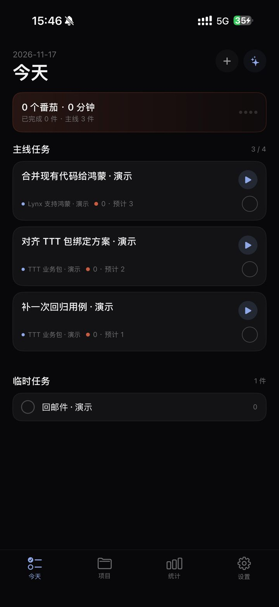
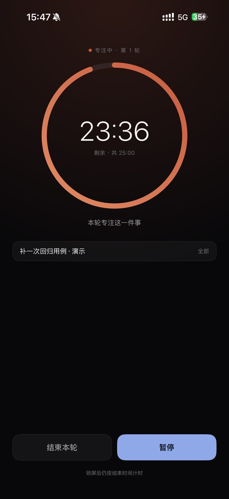
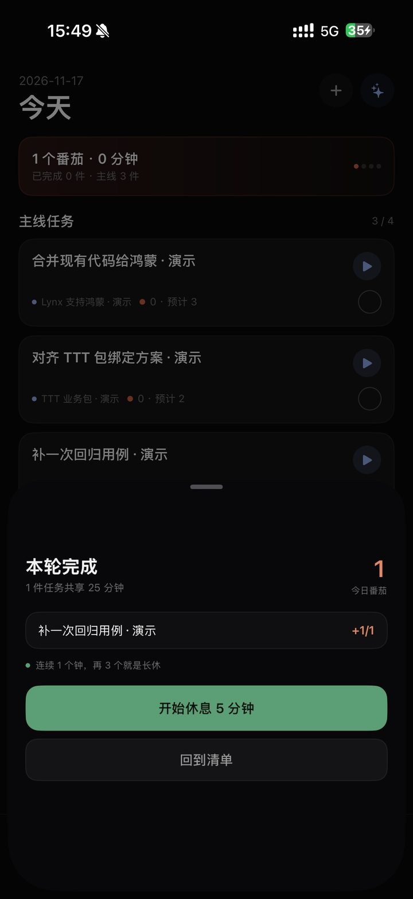
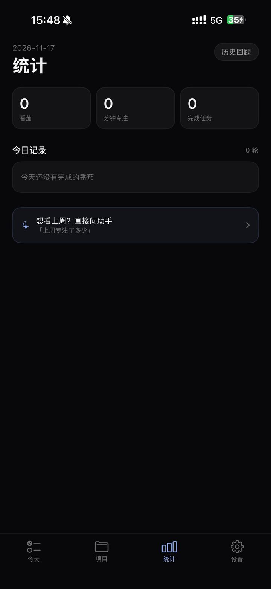
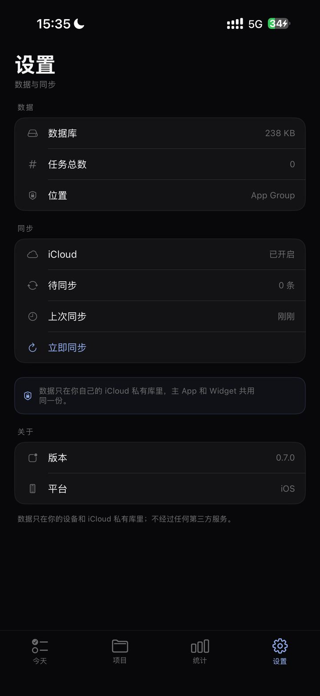
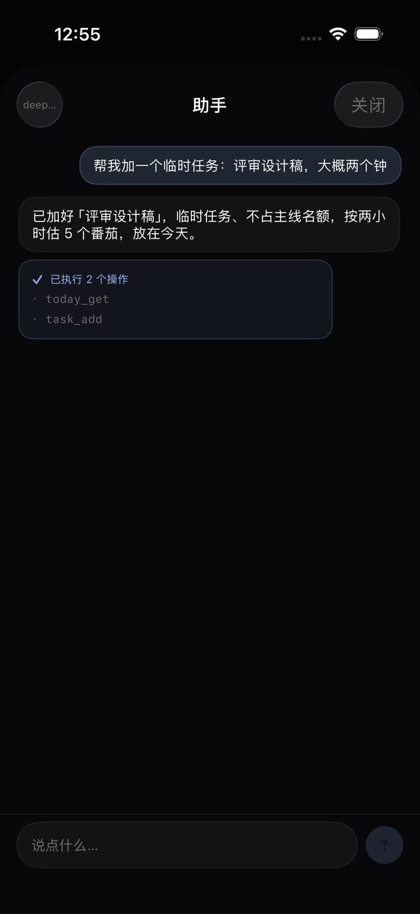
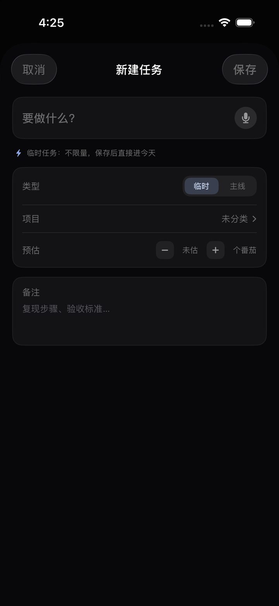
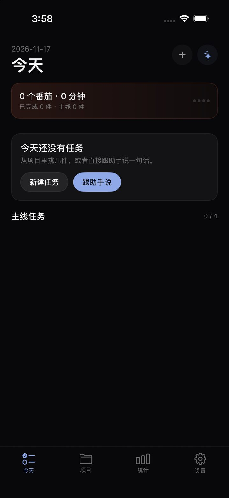
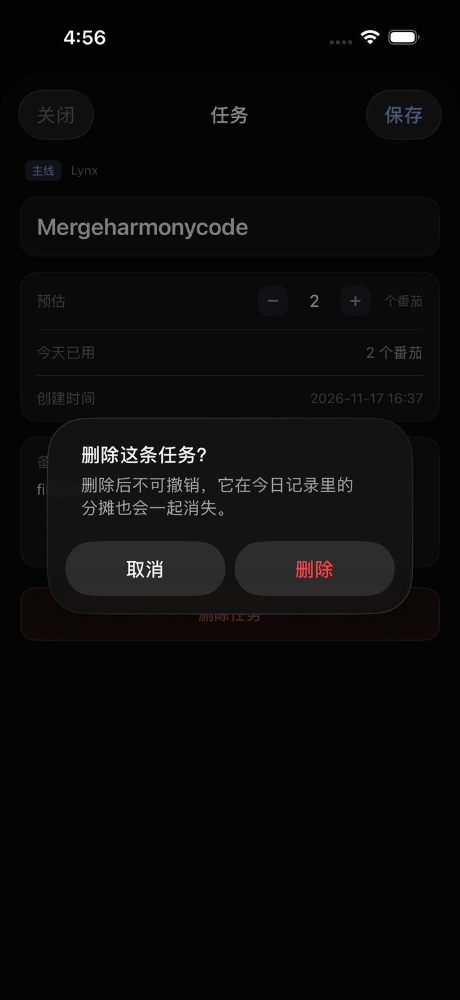

# iOS 版现状、验证记录与交接说明

> 更新于 2026-11-17。这份文档回答三件事：**做完了什么、怎么跑起来、哪些是真验证过的**。

## 一、这个 iOS App 是什么

Mac 版「精力管理」的手机端。它不是另一个产品，而是**同一个数据模型的第二个入口**：

- 只管理今天：开启一天 → 最多 4 件主线 + 若干临时任务 → 共享 25 分钟番茄钟 → 按 1/n 分摊
- 数据通过 **iCloud 私有库**在设备间同步，合并规则与 Mac 端完全相同（字段级 LWW + tombstone）
- 助手用同一套 `AgentCommandRouter`（CLI / Agent 协议 / iOS 三处共用），模型只负责把话变成方法调用

## 二、界面

| 今天 | 专注中 | 本轮完成 |
| --- | --- | --- |
|  |  |  |
| **统计** | **设置** | **助手** |
|  |  |  |

| 新建任务（带语音） | 空状态 | 删除确认 |
| --- | --- | --- |
|  |  |  |

前四张是真机（iPhone 16 Pro Max）截的，其余是模拟器。

## 三、目录

| 路径 | 内容 |
|---|---|
| `Packages/JingliCore/` | 数据层、同步合并规则、Agent 命令路由、CLI |
| `Packages/JingliCore/Sources/JingliSync/` | 传输抽象、SyncEngine、CloudKit 传输、SyncService |
| `Packages/JingliCore/Sources/JingliAgent/` | 工具目录、OpenAI 兼容 provider、Agent 循环 |
| `iOS/Jingli/` | SwiftUI 界面 |
| `iOS/Widget/` | 只读 Widget + Live Activity |
| `iOS/Shared/` | 主 App 与扩展共用类型 |
| `docs/ios-icloud-design.md` | 同步技术方案 |
| `docs/ios-build-plan.md` | 任务拆解与每轮验证记录 |

## 四、跑起来

```bash
cd iOS && xcodegen generate && cd ..

# 模拟器
xcodebuild -project iOS/Jingli.xcodeproj -scheme Jingli -configuration Debug \
  -destination 'generic/platform=iOS Simulator' -derivedDataPath /tmp/jingli-ios-dd build

# 真机（需已在 Xcode 登录开发者账号）
xcodebuild -project iOS/Jingli.xcodeproj -scheme Jingli -configuration Debug \
  -destination 'id=<硬件UDID>' -derivedDataPath /tmp/jingli-ios-dd -allowProvisioningUpdates build
xcrun devicectl device install app --device <UDID> /tmp/jingli-ios-dd/Build/Products/Debug-iphoneos/Jingli.app
```

真机截图（`idevicescreenshot` 在 iOS 17+ 失效）：

```bash
pymobiledevice3 developer dvt screenshot --udid <硬件UDID> --userspace shot.png
```

模拟器自动化点击（真实操作，不是摆参数）：

```bash
idb ui tap --udid <SIM_UDID> <x> <y> --duration 0.1
idb ui describe-all --udid <SIM_UDID> --json
idb ui text --udid <SIM_UDID> "text"
```

## 五、调试启动参数

`devicectl` 传带前导 `-` 的参数时，bundle id 后要加 `--`；`simctl` 直接跟在 bundle id 后面（**不要**用 `--args "a b"`，会被当成一个参数）。

| 参数 | 作用 |
|---|---|
| `-demo` / `-demo-fresh` | 灌演示数据（模拟器） |
| `-seedcheck` / `-cleandemo` | 写入 / 清理带 `·演示` 标记的数据 |
| `-screen=今天\|项目\|统计\|设置` | 直接打开某个 Tab |
| `-startday` / `-endfocus` / `-prepareday` | 自动开一天 / 结束计时 / 一次性串起来 |
| `-autofocus` / `-fasttimer` | 起 25 分钟 / 6 秒的番茄 |
| `-addsheet` / `-detail` | 打开新建任务 / 任务详情 |
| `-asrfile` | 用打包的中文音频跑识别自检 |
| `-voice` / `-ask=…` | 语音识别 / 直接给助手发一句话 |
| `-setllm` | 从 `JINGLI_LLM_*` 环境变量写入模型配置（Key 只进 Keychain） |
| `-ckcheck` / `-cksync` / `-cktwodevice` | CloudKit 自检 / 完整同步 / 双端收敛 |
| `-syncwiring` | 验证「写入 → 去抖 → 自动推送」 |
| `-cleanprobe` | 清掉自检脏数据 |
| `-syncreset` | 换 CloudKit 环境后清游标 + 整库重推（一次性） |

环境变量 `JINGLI_NO_NOTIFICATIONS=1` 关闭真实通知（截图/自检用，避免系统弹窗挡界面）；`devicectl` 前面加 `DEVICECTL_CHILD_` 前缀即可传入。

## 六、验证到什么程度

| 能力 | 证据 |
|---|---|
| CloudKit 往返 | 真机日志 `zone created / push accepted=1 / pull count=1 foundOwn=true` |
| 双端收敛 | 真机日志 `B pulled=28 applied=28 看到A的=true`、`A 看到B的=true` |
| 自动同步 | 真机日志 `写入后待推送=9 → 8 秒后待推送=0` |
| 失败重试 | 单测：失败保留 + 退避重试成功 + 对端收到 |
| 多设备合并 | 单测：不同字段都保留 / 同字段收敛 / 删除传播 |
| 模型操作数据库 | 真机 + 单测：模型调 `task_add` 落一条 temporary、estimate=5 |
| 真机配 Key + 模型建任务 | 真机：Key 写入 Keychain → 「帮我加一个临时任务：评审鸿蒙设计稿，两个番茄」→ 模型调 `today_get`+`task_add` 落 temporary/estimate=2 |
| 真机问数据 | 真机：「今天还剩几件，按项目说一下」→ 「还剩 3 件，Lynx 2 件主线…主线用了 2/4」，数据来自 Mac 同步 |
| 界面配置 Key 后可用 | 模拟器实点：设置填 Key → 助手问「今天还剩几件」→ 正确回答并调 `today_get` |
| 中文语音识别 | 真机日志：TTS 音频 → `帮我加一个临时任务评审设计稿大概两个钟` |
| 语音落录入 | 新建任务页标题栏麦克风，说完直接成为标题 |
| 结算 → 休息 | 实点：开始休息 → 顶部倒计时 → 跳过；休息跨进程保留 |
| 任务详情改/删 | 实点：改标题与预估 → 保存生效；删除走 alert 二次确认，取消保留 |
| 预估边界 | 实点：连加停在 32，连减回到「未估」 |
| 项目增删改 | 实点：新建 / 改名 / 删除（任务转未分类）/ 项目内建任务 |
| 重来今天 | 实点：设置里重置 → 回到「开启一天」，任务退回项目池，番茄记录保留 |
| Widget / App Group | 共享容器直查 sqlite；Widget 编译嵌入安装成功 |
| App 图标 | `devicectl device info appIcon` 直接从手机取回 1024 图标，番茄表盘正常显示 |
| 生产环境发送 | 真机日志 `[CK] push 批次 …` → `pushed=9`、待推送归零；Mac 侧 `[MACCK] push accepted=1` |
| 生产环境接收 | Mac 首次拉取 `pull 结束 记录=3172`；真机 `pulled=3195 applied=3195 skipped=0` |
| 生产环境跨端 | iOS 建的任务出现在 Mac 库（「真机同步验证 150608」）；Mac 删的任务真机侧归零 |
| 空库全量还原 | 第二实例（`JINGLI_SUPPORT_DIR` 空库）首次同步后任务数与主库一致（100/100） |

**没验证的**：真人对着麦克风说话（硬件采集）、动态岛渲染（模拟器不绘制，真机未单独确认）、Widget 添加到桌面。

## 七、已知问题

- 动态岛：真机日志已确认 `Live Activity 已开始，当前活动数=1`、`activityState=active`；
  但 `pymobiledevice3` 截出来的岛区域时有时无（同一条件下一次有黑胶囊、一次空白），
  说明**截图这条观测手段本身不可靠**，需要在手机上看一眼。
- Widget 需要在桌面手动添加，命令行加不了
- Mac 端还没接同步（见下）

## 八、Mac 端同步（已接通，跑在 Production）

三处关键改动：

1. **签名**：`App/project.yml` 从 ad-hoc（`CODE_SIGN_IDENTITY: "-"`）改成自动签名 + 团队 `W695YL8UYY`
2. **权限**：`App/Jingli.entitlements`，含 `iCloud.com.freedom-shen.jingli` + CloudKit，
   并且**必须**显式写 `com.apple.developer.icloud-container-environment`
   —— 没有这一项 macOS 报 `Invalid bundle ID for container`
3. **调度**：`App/Jingli/MacSync.swift`，每 3 秒看一次待推送、每 15 秒拉一次远端

还补了一个之前没意识到的问题：**老数据不会自己同步**。同步靠 SQLite 触发器记录变更，
启用同步之前就存在的行没有任何变更记录，所以第一次同步时对面什么都收不到。
`SyncSchema.backfill` 会把这些行按「行 × 字段」补登记一次（本机实测补了 1740 条）。

端上还有两处补强：iOS 每 15 秒跑一次同步节拍（之前只在专注页的 TimelineView 里 tick，
不专注就永远不拉），助手执行完工具也会立即触发一次推送（agent 直接写库，绕过了模型层）。

实测：Mac 全量数据（98 个任务 / 8 个项目，首次 3172 条变更）→ iPhone 全部到位；iPhone 新建的任务也能被 Mac 拉到，删除能同步回去。

<details>
<summary>当年的可行性实验（保留）</summary>


实验代码在 `Spikes/mac-cloudkit-probe/`。结论：

```
[MAC] accountStatus=1                     ← 账号正常
[MAC] userRecordID ok
[MAC] zone failed: CKError 10/2007 "Invalid bundle ID for container"
```

容器只授权给了 iOS 的 App ID。要接 Mac 得三步：注册 Mac App ID → 分配同一容器 → 把 Mac 工程从 ad-hoc 签名改成自动签名。

</details>

> 分发方式的影响：`scripts/package.sh` 现在会用自动签名产出带开发证书的包。要分发给别人仍需改成 Developer ID / App Store 签名。

## 九、还没做完的两件事（都需要人，不是代码）

都不阻塞日常使用。

### 1. 动态岛看一眼（约 5 秒）

```bash
# 手机上已经装了最新包，直接操作：
打开「精力管理」→ 点任意任务的播放键 → 上滑回桌面
```

预期：动态岛里出现番茄圆点 + 倒计时。
现状：真机日志已确认 `Live Activity 已开始，当前活动数=1`、`activityState=active`；
但命令行截图抓不全系统 UI 层，无法自证。

### 2. 真人语音（约 5 秒）

```bash
# 手机上：今天 → 右上角 + → 标题栏麦克风 → 说一句话
```

预期：说的话实时变成任务标题。
现状：识别链路已用 TTS 音频在真机验证过；只差「人声进麦克风」这一段硬件采集。

## 十、Production 环境（2026-11-18 已切换）

CloudKit 的开发环境和生产环境是两套**独立的 schema 和数据**。开发环境里跑通、
生产环境没部署过 schema 的话，写入会被拒（`push accepted=0`）而 App 只表现为
「同步不生效」—— 这类失败最容易被当成网络问题放过。

### 部署这一步做了什么

CloudKit Console（团队 `xiaomin shen` / `W695YL8UYY`）→ 容器 `iCloud.com.freedom-shen.jingli`
→ 左下 `Deploy Schema Changes…` → 确认。本次部署的内容：

```
Record Types (2)  Probe · SyncChange
Indexes (2)       Probe 3 个 · SyncChange 22 个
Security Roles    _world 角色调整
```

部署后 Production 侧 `Deploy Schema Changes…` 变灰，说明两侧 schema 已一致。

### 切换到生产环境的改动

| 位置 | 改动 |
|---|---|
| `App/Jingli.entitlements` | `icloud-container-environment` → `Production` |
| `iOS/Jingli/Jingli.entitlements` | 新增同名 key = `Production`（开发描述文件同时允许两个值，所以仍能正常签名安装） |
| `SyncStore.resetForNewEnvironment()` | 清 `pull_cursor` / `last_sync_at` / `sync_retry`，并把所有 `pushed_at` 置空 |
| 两端启动参数 `-syncreset` | 切环境后跑一次，把整库重推到空的生产库 |

生产库是空的，**不清游标**的话：拉取带着开发环境的 token（报错或被忽略），
推送则因为 `pushed_at` 有值而永远不再发，数据一条都过不去。

### 顺带修掉的两个「静默失效」

1. **拉取用了废弃的回调 API**：`CKFetchRecordZoneChangesOperation` 在 Production 里
   完成回调根本不触发，`withCheckedThrowingContinuation` 永不 resume，`SyncEngine`
   这个 actor 就永久卡住；`SyncService.syncing` 一直是 true，之后每次同步都被 `guard`
   挡掉，日志只有「同步完成 错误=nil」。改成 async 版 `recordZoneChanges` + 120 秒超时。
2. **补录只做一次**：`backfill.v2` 标记让备份恢复 / 批量导入进来的行永远补不上
   （本机实测有 22 个任务一条变更记录都没有，所以另一台设备上根本不存在）。
   现在每次启动都跑补录，判据从「有没有变更记录」改成「这个字段有没有 rev」，
   避免把从对端拉下来的数据误当成新数据再推一遍（那样会带着全新 rev 覆盖对端）。

另外给 `modifyRecords` 也加了 60 秒超时，并把真正跑网络的那次 sync 放进 detached 任务，
免得去抖任务被新写入 cancel 时把同步半路掐断（表现为 `CancellationError`）。

## 十一、快速添加任务（快捷指令 / Siri / 操作按钮）

三条路，都是同一个落库逻辑（`WorkspaceStore.createTask`，写入后由同步节拍推上去）。

### 1. 快捷指令 App 里的动作（推荐）

`快捷指令` → 新建 → 添加操作 → 搜索 **精力管理** → **加一个任务**

- 参数：任务内容（必填）、类型（默认临时）、预估番茄数（1–32，可空）
- 因为是普通 `AppIntent`，可以接上一步的输出，做成「复制一段文字 → 加进今天」、或者固定文案的「一键记一笔」
- 建好的快捷指令可以放到**主屏 / 操作按钮 / 控制中心**

### 2. 快捷指令 App 里的 App 快捷指令卡片

`快捷指令` → 资料库 → 精力管理 → **快速加任务** → 打开新建任务页，键盘就绪。

> 这里刻意做成**零参数**：带必填参数的 intent 在资料库里点卡片跑不起来（没有地方填参数，
> iOS 只弹一句「无法运行 App 快捷指令」），所以卡片只负责打开输入界面。

### 3. Siri

「用精力管理加个任务」「在精力管理记一笔」

### 4. 深链（给自动化和其它 App）

```
jingli://add                打开新建任务页
jingli://add?title=写周报   打开并预填标题
```

快捷指令里也可以用 **打开 URL**，配合「询问输入」做任意自动化。

### 验证记录

| 环节 | 证据 |
|---|---|
| 卡片注册 | 模拟器「快捷指令 → 资料库」出现 `精力管理 / 快速加任务`，图标是新版番茄 |
| 深链预填 | `simctl openurl jingli://add?title=…` → 新建任务页标题栏已是「深链验证」 |
| 深链落库 | 点保存 → 库中 `深链验证 / temporary / 2026-11-18`，界面上出现在「开启一天」池子里 |
| 卡片点击 | **模拟器跑不了**：`linkd` 报 `Couldn't find AppShortcutsProvider`，涂鸦智能自带的卡片同样报错，属于模拟器环境限制；真机需人工点一次 |

### 参数化 intent 为什么不挂在卡片上

`AppShortcutsProvider` 的卡片在资料库里点击时没有参数输入界面，带必填参数的 intent 会直接失败。
所以卡片用零参数的 `OpenAddTaskIntent`（打开输入页），参数化的 `AddTaskIntent` 留给「添加操作」和 Siri。
